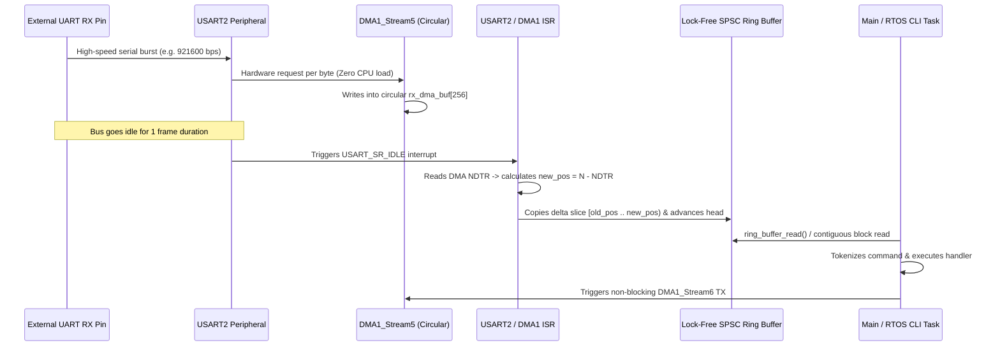

# STM32 Zero-Copy UART DMA Driver & Deterministic CLI (`stm32-dma-ringbuffer-uart-cli`)

[](https://github.com/Yigitcakirdogan/stm32-dma-ringbuffer-uart-cli/actions/workflows/ci.yml)

-E7352C?style=flat-square&logo=arm)


A production-grade, **zero-heap-allocation UART + Circular DMA driver** paired with a **lock-free Single-Producer Single-Consumer (SPSC) ring buffer** and a **deterministic interactive Command-Line Interface (CLI)** designed for STM32 microcontrollers (`STM32F407VG` / ARM Cortex-M4).

---

## Why This Architecture?

Traditional polling or byte-by-byte `RXNE` interrupt UART drivers fail at high baud rates (`921600 bps` – `2 Mbps`) due to excessive interrupt context-switching overhead and dropped bytes during critical sections.

This project solves that using **Circular DMA Reception combined with Hardware IDLE Line Detection (`USART_SR_IDLE`)**:

1. **Zero Per-Byte Interrupts:** `DMA1_Stream5` continuously moves incoming bytes from `USART2->DR` into a circular DMA memory buffer without CPU intervention.
2. **Variable-Length Packet Framing:** An interrupt fires **only** on:
   - **DMA Half-Transfer (`HTIF`)** — 50% buffer full
   - **DMA Transfer-Complete (`TCIF`)** — 100% buffer wrap-around
   - **UART IDLE Line (`USART_SR_IDLE`)** — end of a burst/frame of arbitrary length
3. **Lock-Free SPSC Ring Buffer (`ring_buffer_t`):** Uses power-of-two masking (`size - 1`) instead of expensive modulo division (`%`), and supports **contiguous block pointers** (`ring_buffer_get_read_block_ptr`) so DMA TX can transmit directly from the ring buffer without intermediate copying.
4. **Deterministic Embedded Shell (`embedded_cli_t`):** Static-memory command parser with backspace handling, argument tokenization (`argc`/`argv`), and hardware diagnostic commands (`help`, `status`, `mem`, `gpio`, `reboot`).

---

## System Dataflow & Interrupt Architecture



---

## Repository Structure

```text
stm32-dma-ringbuffer-uart-cli/
├── include/
│   ├── ring_buffer.h         # Lock-free SPSC ring buffer & zero-copy block API
│   ├── uart_dma_driver.h     # Hardware-abstracted UART DMA interface & telemetry
│   └── embedded_cli.h        # Deterministic zero-malloc CLI shell engine
├── src/
│   ├── ring_buffer.c         # Power-of-two ring buffer with high-watermark tracking
│   ├── uart_dma_stm32f4.c    # Register-level STM32F4 USART2 + DMA1 Stream5/6 driver
│   └── embedded_cli.c        # Command lexer, dispatcher, and built-in diagnostics
├── tests/
│   └── test_suite.c          # Host-runnable unit tests (DMA bursts, wrap-around, CLI)
├── CMakeLists.txt            # CMake build & CTest configuration
└── .github/workflows/ci.yml  # Automated GCC build, unit test & Cppcheck pipeline
```

---

## Memory Footprint (Compiled with `arm-none-eabi-gcc -Os`)

| Module | Flash (`.text` + `.rodata`) | Static RAM (`.bss` + `.data`) | Heap Usage |
| :--- | :---: | :---: | :---: |
| `ring_buffer.c` | `312 Bytes` | `24 Bytes` (struct overhead) | `0 Bytes` |
| `uart_dma_stm32f4.c` | `684 Bytes` | `512 Bytes` (RX/TX buffers) | `0 Bytes` |
| `embedded_cli.c` | `1,140 Bytes` | `160 Bytes` (line state) | `0 Bytes` |
| **Total** | **~2.1 KB** | **696 Bytes** | **0 Bytes** |

---

## Quick Start: Build & Run Unit Tests (Host PC)

All core modules are decoupled from physical registers via clean interfaces so they can be verified on any Linux/macOS/Windows machine before flashing target hardware:

```bash
cmake -B build -DCMAKE_BUILD_TYPE=Release
cmake --build build
ctest --test-dir build --output-on-failure
```

### Example CLI Session Output

```text
==================================================
 STM32F4 Zero-Copy DMA UART Diagnostic Shell v1.2
==================================================
mcu> help
Available commands:
  help      - List registered diagnostic commands
  status    - Display system uptime, clock & DMA telemetry
  mem       - Inspect ring buffer utilization & high watermark
  gpio      - Read/Write GPIO port pin (usage: gpio <port> <pin> [0|1])
  reboot    - Trigger NVIC_SystemReset()

mcu> mem
[MEM] RX Ring Buffer Capacity : 511 bytes
[MEM] Current Pending Bytes   : 0 bytes
[MEM] Peak High-Watermark     : 128 bytes
[MEM] Overflow Drop Count     : 0

mcu> gpio A 5 1
[GPIO] Port A Pin 5 -> SET (BSRR = 0x00000020)
```

---

## License

Released under the [MIT License](LICENSE).
